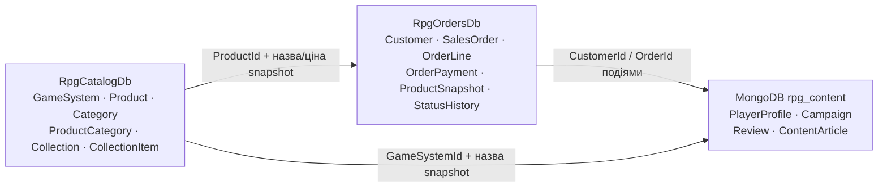
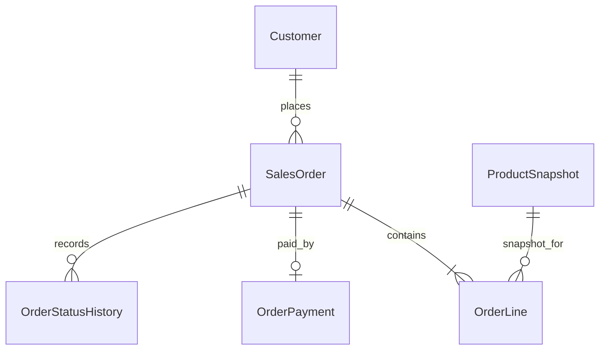
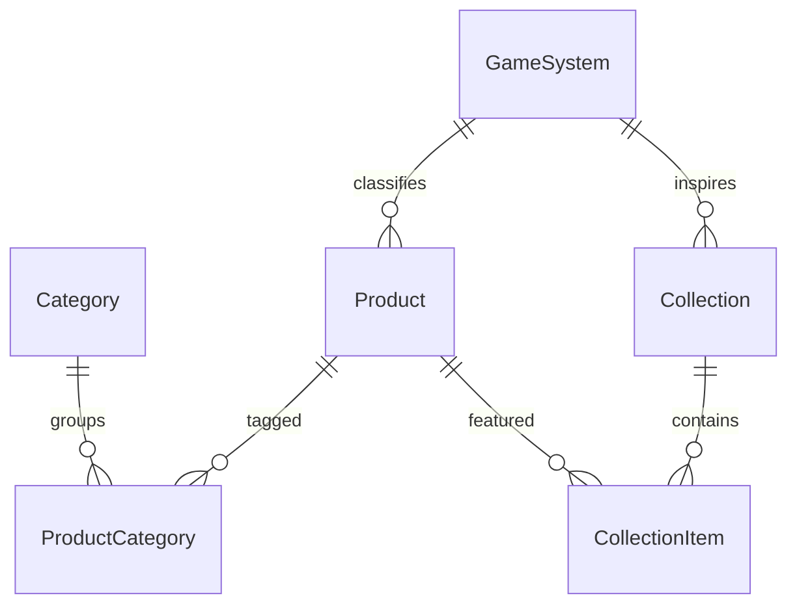

# Архітектура сховищ

## Межі контекстів

Стрілки показують інтеграційні повідомлення та копіювання ідентифікаторів/знімків, не FK. Єдині SQL foreign keys знаходяться всередині своєї бази.

## ERD SQL

### Проєкт №1 — оформлення замовлення

`OrderPayment.OrderId` є водночас PK і FK, тож це 1:1. `OrderLine` реалізує M:N між `SalesOrder` та `ProductSnapshot`; власні атрибути зв'язку — кількість і ціна/назва на момент покупки. `ProductSnapshot` належить контексту замовлень і зберігає лише інформацію, потрібну для відтворення замовлення. Індекс `IX_SalesOrder_Customer_PlacedAt` обслуговує історію замовлень клієнта; `IX_SalesOrder_Status_PlacedAt` — чергу виконання; `IX_OrderLine_Product` — пошук замовлень за товаром; `IX_OrderStatusHistory_Order_Changed` — часову шкалу статусу.

У таблицях із змінюваними даними є створення/оновлення/м'яке видалення та `rowversion`; процедурі зміни статусу можна передати очікувану версію. `OrderLine` рядки каскадно видаляються фізично лише разом із батьківським замовленням; статусне журналювання зберігається на рівні замовлення. Застосунки мають віддавати перевагу soft delete.

### Проєкт №2 — каталог і підбірки

Є шість сутностей; `ProductCategory` і `CollectionItem` є явними M:N-сутностями з власними `AssignedAt` та `Position/AddedAt`. Індекси: `IX_Product_Active_Type_Price` для фільтрації активного асортименту за типом/ціною, індекс за CategoryId для отримання товарів категорії, індекс за ProductId для пошуку підбірок товару.

## MongoDB: форма документів і запити

У `PlayerProfile` вбудовані налаштування та персонажі: читаються разом із профілем, змінюються разом і мають обмежений розмір. `Campaign` вбудовує учасників, сесії й safety tools для швидкого читання сторінки кампанії. Водночас він зберігає посилання `gameSystemId`, `productIds`, `organizerCustomerId` і `profileId` на незалежні контексти/документи; `gameSystemName` — контрольований знімок для відображення без синхронного запиту до каталогу. `Review` гібридний: посилання на товар/автора/замовлення плюс знімки назви та статусу покупки, вбудовані аспекти, відповіді й необов'язкова анкета. `ContentArticle.blocks` демонструє гнучку схему блоків різної форми. Валідація кожної колекції задає мінімальні обов'язкові поля та дозволяє додаткові поля.

Основні запити: профіль за унікальним `handle`; кампанії системи за `gameSystemId` із сортуванням за `updatedAt`; відгуки товару за `productId`/датою та унікальний відгук автора на товар; стаття за унікальним slug. Seed використовує стабільні ID і replace/upsert, тому повторний запуск оновлює демонстраційні записи, не створюючи копій.

## Збережені процедури p1

`Customer_Upsert` — створення/оновлення профілю; `Order_Create` — створює draft і початковий запис журналу; `OrderLine_Add` — додає рядок зі знімком ціни; `Order_SetStatus` — дозволений граф переходів із явною транзакцією, блокуванням рядка, optimistic concurrency та контрольованими помилками; `Order_Get` — читає замовлення, рядки й історію. Граф переходів: Draft→Placed/Cancelled, Placed→Paid/Cancelled, Paid→Packed/Cancelled, Packed→Shipped, Shipped→Completed.
