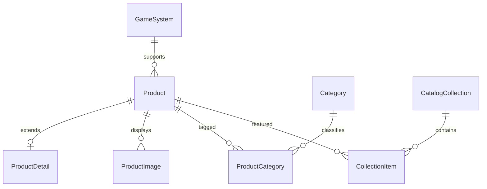

# Catalog: model and Fluent API

The model belongs to `Catalog.Domain`; EF Core mapping belongs to `Catalog.Dal`. Every entity has an individual `IEntityTypeConfiguration<T>` under `Catalog.Dal/Configurations`. `AppDbContext.OnModelCreating` applies these configurations centrally with `ApplyConfigurationsFromAssembly`.



* `ProductDetail.ProductId` is both primary key and foreign key to Product (1:1).
* `ProductImage.ProductId` is a foreign key on the many side (Product 1:N ProductImage).
* Product ↔ Category uses explicit `ProductCategory`, with composite PK and its own `AddedAt`/`AssignedBy` fields (M:N). `CollectionItem` is another explicit join entity and stores `Position`/`AddedAt`.
* Domain constructors and methods enforce required values, positive price, nonnegative stock, valid stock changes, and absolute HTTP(S) image URLs. Setters are private.
* Fluent mappings specify key generation, required/max lengths, `decimal(18,2)`, rowversion, defaults, unique/filtered indexes, CHECK constraints, fixed lookup data, and deliberate cascade/no-action behavior.

## Initial migration and manual SQL schema

`Services/Catalog/Catalog.Dal/Migrations/` contains the initial migration, designer metadata, and EF model snapshot. `db/p2/catalog-ef-migrations.sql` is the idempotent SQL Server script generated from that migration. For a clean database, use either `dotnet ef database update` or the generated migration script; do not apply `db/p2/schema.sql` first and then run the EF migration against the same database, because the SQL schema creates the tables without adding an EF migration-history record.

The independent manual schema script `db/p2/schema.sql` is also aligned to the model's new 1:1/1:N tables and product price precision/check rule.

## Repositories and Unit of Work

`Catalog.Dal/Repositories/IGenericRepository<TEntity>` defines asynchronous DbSet-backed CRUD. `BaseEfRepository<TEntity>` implements it once and only stages changes in the shared `AppDbContext`; it does not call `SaveChanges`. `IProductRepository`, `IProductImageRepository`, and `IProductCategoryRepository` extend the generic contract with the catalog-specific queries:

* `ProductRepository.GetWithCatalogAsync` uses eager loading (`Include`/`ThenInclude`) for system, detail, and categories.
* `ProductImageRepository.LoadForProductAsync` uses explicit loading for images of an already tracked product.
* `ProductCategoryRepository.GetAssignmentsForProductAsync` uses a LINQ join over the M:N association and returns category data together with `AddedAt` and `AssignedBy`.

`ICatalogUnitOfWork` exposes the three specific repositories and the one commit method, `SaveChangesAsync`. Dependency injection registration is centralized in `AddCatalogDal`; DbContext, repositories, and Unit of Work are scoped so each request receives one context instance. For example, a caller stages an entity with `await uow.Products.AddAsync(product, ct)` and then persists all staged repository changes with `await uow.SaveChangesAsync(ct)`.

To verify this criterion, build the DAL from the repository root:

```powershell
dotnet build Services\Catalog\Catalog.Dal\Catalog.Dal.csproj --no-restore -p:NuGetAudit=false
```

The three query strategies and shared-context registrations are source-level DAL behaviors; they do not require changing the database schema or rerunning migrations.

## Data, queries, and validation

Lookup rows (`GameSystem`, `Category`) use fixed-key EF `HasData`; `CatalogDatabaseInitializer` calls `MigrateAsync` and inserts the sample product only when neither its ID nor SKU exists. `Database:InitializeOnStartup` controls this startup initialization and can be disabled with `false` when deployment migrations/seeding are managed externally.

`ProductCatalogSpecification` declares the product filter, GameSystem include, allowlisted sort expression, and page window. `SpecificationEvaluator` applies those expressions in the DAL before `ToListAsync`; `CountAsync` supplies total count for the same filter. The API response includes `totalCount`, `totalPages`, `hasNext`, and `hasPrevious`.

Create, update, and search DTOs have DataAnnotations. Separate FluentValidation validators are registered from the BLL assembly and explicitly executed by `ProductService`; failures become `ValidationProblemDetails`. Serilog writes structured console events, includes request logging and context properties, and records EF Core SQL command events at Information level. See [catalog-api.md](catalog-api.md) for requests that exercise paging and validation.
