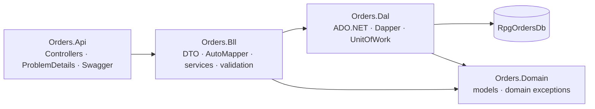

# Orders API: вертикальний зріз

## Залежності

Контролери залежать від BLL. BLL перевіряє інваріанти та використовує DTO/AutoMapper, DAL ізолює весь SQL. `CustomerRepository` і `OrderLineRepository` читають вручну через `SqlDataReader`; `SalesOrderRepository` та `ProductSnapshotRepository` використовують спільний `BaseDapperRepository<T>` для Create/Read/Update/soft Delete. `SalesOrderRepository.GetWithCustomerAsync` демонструє Dapper multi-mapping і повертає замовлення разом із моделлю клієнта. У межах scoped запиту UoW, репозиторії й `SqlSession` використовують одну `SqlConnection`; явна транзакція задає рівень `ReadCommitted`, має commit/rollback і звільнення ресурсів. Для generic-репозиторію ключ передається як `object`, щоб підтримувати Guid ключі агрегатів і числовий `OrderLineId` без підміни його семантики.

`OrderService.CreateAsync` читає клієнта/товари й у транзакції записує SalesOrder та набір OrderLine. Рядок зберігає snapshot назви й ціни з ProductSnapshot. Якщо будь-яка позиція невалідна чи товар відсутній, UoW відкочує всі вставки. Зміна статусу проходить через транзакційну `Order_SetStatus`, яка блокує рядок, перевіряє `rowversion`, дозволений граф переходів і додає запис історії.

## HTTP контракт

| Метод | Шлях | Результат |
|---|---|---|
| GET | `/api/customers`, `/api/customers/{id}` | Список або клієнт |
| POST / PUT / DELETE | `/api/customers`, `/api/customers/{id}` | Створити (`201`), оновити (`200`), soft delete (`204`) |
| GET | `/api/products`, `/api/products/{id}` | Список або товарного snapshot |
| POST / PUT / DELETE | `/api/products`, `/api/products/{id}` | Створити (`201`), оновити (`200`), soft delete (`204`) |
| GET | `/api/orders`, `/api/orders/{id}` | Замовлення з позиціями |
| POST / DELETE | `/api/orders`, `/api/orders/{id}` | Транзакційне створення (`201`) або soft delete (`204`) |
| PATCH | `/api/orders/{id}/status` | Бізнес-перехід статусу (`200`) із `status` та `rowVersion` |

Глобальний exception handler перетворює доменні винятки у `ProblemDetails`: Validation → 400, NotFound → 404, BusinessConflict → 409. DataAnnotations відхиляють некоректне тіло до виклику сервісу. Невідомі помилки логуються й повертають узагальнений 500 без внутрішніх деталей.

## Нотатки до розгортання

AppHost оголошує SQL Server і ресурс `RpgOrdersDb`, передає connection string через `WithReference` та чекає на готовність БД. API стартовий `IDatabaseInitializer` виконує SQL-файли з p1 як embedded resources через DAL, поділяючи батчі по `GO`. Виробниче розгортання може виконати ті самі SQL-файли окремим migration/deployment кроком і вимкнути `Database:InitializeOnStartup`.
